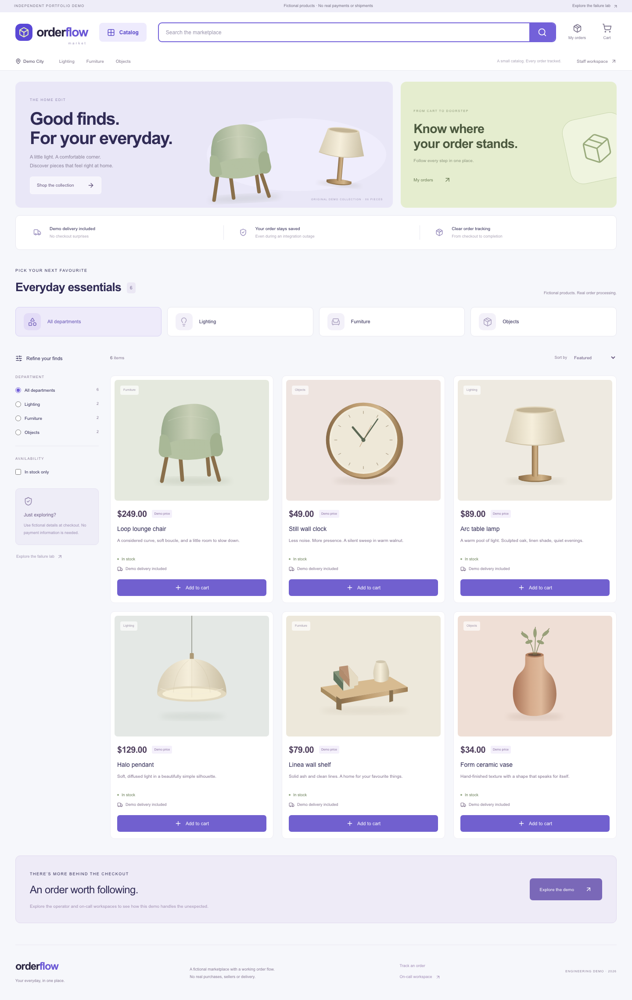
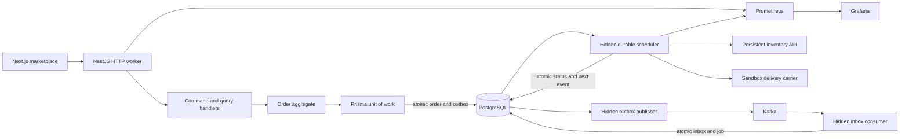
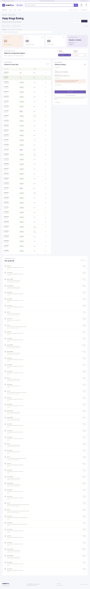

# OrderFlow Market

[](https://github.com/vadimoarturo/order-flow/actions/workflows/ci.yml)

**A marketplace-style shopping experience with a real, recoverable order backend.**

OrderFlow is an independent **fictional portfolio demo**. Browse a small catalog, search and filter products, adjust the cart, place an order and track its status. Operator and on-call workspaces demonstrate business progression and integration recovery.

Catalog, inventory, orders, outbox, inbox, jobs and audit records live in real PostgreSQL through **Prisma**. Events travel through real **Kafka**. Inventory reservation executes an atomic stock transaction. Only the delivery carrier is explicitly a **sandbox**; no real payments or shipments take place.

No client, employer code, private packages, production deployment, operational results or performance figures are claimed. This is a limited marketplace flow, without seller onboarding, multiple sellers or split orders.



## Start the complete stack

Requirements: Docker Engine / Docker Desktop with Compose v2, approximately 6 GB of available Docker memory and free ports **3000, 3001, 4000, 4001, 5432, 9090, 9092**. The initial build needs internet access.

```sh
# If .env already exists, edit it instead of overwriting it.
cp .env.example .env
docker compose up -d --build --wait --wait-timeout 240
docker compose ps
```

Compose builds the backend/frontend and monitoring images, applies Prisma migrations and seeds six fictional products. Seeds use non-destructive upserts: subsequent launches preserve orders, inventory, operation receipts and failure-lab state. All published ports bind to loopback.

| Interface | URL | Default local access |
| --- | --- | --- |
| Marketplace | <http://localhost:3000> | Public |
| My orders | <http://localhost:3000/orders> | Tracking capabilities stored in this browser |
| Operator | <http://localhost:3000/operator> | Staff token `operator-demo-local` |
| On-call | <http://localhost:3000/operations> | Staff token `oncall-demo-local` |
| OpenAPI / Swagger | <http://localhost:4000/docs> | Local HTTP worker |
| Hidden health | <http://localhost:4001/health> | Operational endpoint |
| Grafana | <http://localhost:3001/d/orderflow> | `admin` / `admin-demo-local` |
| Prometheus alerts | <http://localhost:9090/alerts> | Local only |

These credentials are intentionally public, local demo values. Use your configured `.env` values when changed. The shared staff tokens demonstrate server-enforced roles; they are not production user authentication.

Stop with `docker compose down`. Named volumes remain. There is no need to reset data between launches. The previous local draft was explicitly baselined into Prisma without clearing its database; [migration notes](docs/MIGRATIONS.md) explain that one-time bridge. Fresh databases use ordinary `prisma migrate deploy`.

## One backend, explicit process roles

All backend processes execute **the same `apps/api/dist/main.js`**. `main.ts` only selects the runtime module, configures HTTP validation/Swagger and starts Nest. It contains no controllers or SQL.

| `APP_ROLE` | Compose service | Responsibility |
| --- | --- | --- |
| `worker` | `worker` | HTTP API, catalog, checkout, order queries and staff commands. Does not instantiate Kafka consumers. |
| `hidden` | `hidden` | Outbox publisher, Kafka inbox acceptance and leased integration scheduler. Exposes only health/metrics. |
| `integrations` | `integrations` | Persistent inventory reservation and the sandbox carrier, on the private Compose network. |

Unknown roles fail before startup. Domain/application code is shared across these roles; HTTP and background work do not require separate backend codebases.



## Domain boundaries

```text
apps/api/src/
  main.ts
  runtime.module.ts
  modules/
    orders/
      domain/                 # Rich aggregate, lines, events, interfaces
      application/            # Use cases, commands, queries, handlers, response mapper
      infrastructure/         # Prisma repositories / unit of work
      controllers/            # Nest controllers, DTOs and HTTP adaptation
    catalog/
    inventory/                # Stock entity and persistent reservations
    fulfillment/              # Inbox, durable tasks, retries and integration gateway
    operations/               # Diagnostics, dependency controls and audited recovery
    delivery/                 # Carrier port and sandbox adapter
    identity/                 # Shared demo roles and guards
  libs/prisma/
  libs/observability/
  common/
apps/web/
  app/                        # Separate App Router pages
  features/                   # Catalog, cart, tracking and staff components
```

Domain objects contain business rules and do not import NestJS or Prisma. Application services depend on domain ports. Nest modules register concrete adapters and CQRS handlers through DI. Controllers contain request adaptation and validated DTOs, with no database queries. `npm run check:architecture` checks these dependency directions.

The order aggregate owns item snapshots, integer-cent totals, allowed transitions, versions and domain events. The stock entity rejects invalid or insufficient reservations. Prisma handles persistence; parameterized raw PostgreSQL is limited to row/advisory locks, `SKIP LOCKED`, database-clock reads and migration/test fixtures.

[Architecture notes](docs/ARCHITECTURE.md) cover isolation, crash windows, indexes, idempotency and the **unimplemented** sharding proposal.

## Demonstrate failure and recovery

1. Place a demo order using fictional delivery details. Follow `placed → reserved → ready` on the tracking page.
2. In Operator, mark it `dispatched`, then `completed`. Every change checks the current aggregate version and records a reason.
3. In On-call, enter a meaningful reason and choose **Simulate outage** for Delivery. Place another order.
4. Inventory reserves real demo stock. Carrier calls fail with HTTP 503. The hidden scheduler persists short and delayed retries; the Kafka consumer returns after storing inbox/job.
5. After five failed attempts the job remains in a database-backed DLQ, usually within about a minute. Inspect its error, attempts and trace ID. View the DLQ gauge in Grafana and the firing Prometheus alert.
6. Restore Delivery and choose **Retry task** with a reason. The original external operation key remains unchanged. Verify the succeeded job, `ready` order and audit entry.

Manual **Skip** is available only for DLQ jobs and marks the order `attention`. It never falsely completes delivery or releases stock. Full diagnosis and recovery instructions: [on-call runbook](docs/RUNBOOK.md).



## Tests and local development

Node.js 22 is recommended for host tools. Chromium is used by Playwright; Java 17+ is needed only to generate the Allure HTML report.

```sh
npm ci
npm run check:architecture
npm run format:check
npm run typecheck
npm test
# Builds backend and creates/removes its own PostgreSQL test database.
bash scripts/test-integration.sh
# Requires the complete Compose stack, including Prometheus.
npx playwright install chromium
npm run test:e2e
npm run allure
npx playwright show-report
```

Unit `*.spec.ts` files are **co-located** with the entity/service/use case. They isolate business rules with test doubles at ports where useful. Integration tests exercise actual Prisma/PostgreSQL transactions, uniqueness, outbox rollback, lease fencing, stock contention and Nest role composition. Browser tests exercise the live HTTP → Kafka → inbox → scheduler → inventory/carrier path, plus failure, firing alert, recovery, role restrictions and marketplace controls.

GitHub Actions is configured to build/start Compose, run checks and tests, and retain reports, failed-test traces and service logs. See [GitHub Actions](https://github.com/vadimoarturo/order-flow/actions/workflows/ci.yml) for remote run status. Actual local results are recorded in [VERIFICATION.md](docs/VERIFICATION.md).

Browser tests add fictional orders and consume inventory in the live demo. SQL integration tests use a dedicated temporary database. If you change local passwords/tokens, export the corresponding values before host-side tests; the SQL test script uses `POSTGRES_PASSWORD` and E2E uses `OPERATOR_TOKEN` / `ONCALL_TOKEN`.

For editing, stop the corresponding Compose application process before using its port. Export the values from `.env.example` into your development shell, then run `npm run dev:api` and `npm run dev:web`. For a host hidden process, use `APP_ROLE=hidden PORT=4001 npm run dev:api`; for integrations use `APP_ROLE=integrations PORT=4100 npm run dev:api`. Default host broker is `localhost:9092`. The production role commands all use `node apps/api/dist/main.js` with `APP_ROLE` set explicitly.

## Versions and decisions

| Layer | Pinned choice | Reason |
| --- | --- | --- |
| Runtime | Node.js 22 container | Shared runtime for Nest and Next |
| Backend | NestJS 11.2.8, CQRS 11.0.3, TypeScript 5.9.3 | Modules, guards, handlers, DTO validation and explicit process roles |
| Persistence | Prisma 6.19.3, PostgreSQL 16.13 | Versioned migrations, typed repositories and interactive transactions |
| Frontend | Next.js 16.4.5, React 19.3.1 | Separate routes and interactive feature components |
| UI | Tailwind CSS 4.3.5, original CSS/SVG | An original marketplace layout and responsive visual system |
| Events | Kafka 3.9.1 KRaft, KafkaJS 2.2.4 | Real keyed event transport with durable inbox acceptance |
| Monitoring | Prometheus 3.2.1, Grafana 11.6.0 | Versioned dashboard, data source and local alert rules |
| Verification | Node test runner, Playwright, Allure | Pure rule checks, real database scenarios and browser evidence |

Versions are pinned in `package-lock.json`. Prisma 6's transaction API is used deliberately; see the official [transaction documentation](https://www.prisma.io/docs/orm/v6/prisma-client/queries/transactions). SQL checks and partial indexes live in migrations. Container image version tags are pinned; digest pinning and automated updates are future hardening.

## Portfolio and scope

- [English portfolio PDF](docs/OrderFlow-Portfolio.pdf) — actual product screens and implemented capabilities.
- [Suggested Upwork copy](docs/UPWORK.md) — not uploaded.
- [Architecture](docs/ARCHITECTURE.md), [API reference](docs/API.md), [runbook](docs/RUNBOOK.md).
- [Verification record](docs/VERIFICATION.md) and [machine-readable results](docs/verification.json).
- [Краткое пояснение на русском](docs/README.ru.md).

`node scripts/capture.mjs` refreshes stable product/staff/Grafana/Allure screenshots after the browser tests and report generation. `node scripts/presentation.mjs` generates the PDF from those screens and the verification manifest.

This is not a production marketplace: no real payments/carrier, seller management, split orders, identity provider, cancellation/refund/compensation saga, implemented sharding, HA broker, benchmark, production deployment or notification delivery. Shared role tokens are for a local demo. The carrier is sandboxed; inventory and order processing are real persisted workflows. Metrics and logs use correlation IDs, without an OpenTelemetry span viewer or centralized log store. Lists are bounded to 100 latest records and audit to 50. Database/Kafka volumes persist; there is no reset or replenishment UI.

Source and demo evidence are published at [vadimoarturo/order-flow](https://github.com/vadimoarturo/order-flow). Changes are recorded in separate Git commits. Portfolio copy is provided for review; no Upwork upload or hosted production deployment is included.
